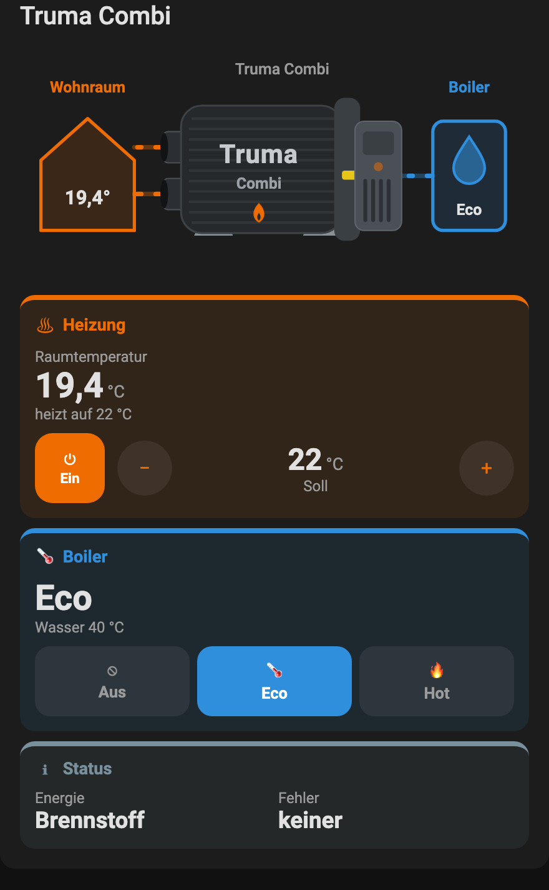

# Truma Card

Lovelace-Karte für Home Assistant, die eine Truma Combi Heizung samt Boiler
anzeigt und steuert:

| Funktion | Konfigurationsschlüssel |
|---|---|
| Raumtemperatur, Soll-Temperatur, Ein/Aus | `climate` |
| Boiler Aus / Eco / Hot | `boiler` |
| Energiemix (nur Anzeige) | `energy_mix` (optional) |
| Fehlercode (nur Anzeige) | `error` (optional) |

Oben zeigt eine schlichte Grafik Wohnraum ← Truma Combi → Boiler mit
animierten Warmluft- und Wasserleitungen (Geschwindigkeit abhängig von der
Differenz Soll–Ist). Darunter stehen die Werte und Bedienelemente in
farbigen Gruppen, passend zur Grafik:

- **Orange – Heizung:** Raumtemperatur, Ein/Aus, Soll-Temperatur mit − / +
- **Blau – Boiler:** aktueller Modus und Auswahl Aus / Eco / Hot (Hot rot)
- **Grau – Status:** Energiemix und Fehler (rot, sobald ein Fehler anliegt)



## Installation über HACS

1. HACS öffnen → Menü (⋮) → **Benutzerdefinierte Repositories**.
2. `https://github.com/abcklaus/truma-card` eintragen, Typ **Dashboard** (früher „Lovelace“) wählen.
3. „Truma Card“ suchen und herunterladen.
4. Browser neu laden (Cache leeren).

HACS legt die Ressource `/hacsfiles/truma-card/truma-card.js`
automatisch an.

### Manuell

`dist/truma-card.js` nach `/config/www/` kopieren und unter
*Einstellungen → Dashboards → Ressourcen* als JavaScript-Modul
`/local/truma-card.js` hinzufügen.

## Konfiguration

Die Karte lässt sich komplett im grafischen Editor einrichten
(„Karte hinzufügen“ → „Truma Card“). Als YAML:

```yaml
type: custom:truma-card
name: Truma Combi
climate: climate.truma_air
boiler: select.truma_combi_d_4_truma_boiler
energy_mix: select.truma_combi_d_4_energy_mix
error: sensor.truma_combi_d_4_error
```

### Alle Optionen

| Option | Typ | Standard | Beschreibung |
|---|---|---|---|
| `name` | string | `Truma Combi` | Titel; leer = kein Kopfbereich |
| `climate` | entity | – | Thermostat der Heizung (`climate.*`) mit `current_temperature` |
| `boiler` | entity | – | Auswahl-Entität (`select.*`) mit den Optionen des Boilers, z. B. `Aus`, `Eco`, `Hot` |
| `energy_mix` | entity | – | Energiemix (`fuel` / `electricity` / `mix`), nur Anzeige |
| `error` | entity | – | Fehlercode; `none` gilt als „kein Fehler“ |
| `default_temperature` | number | `20` | Soll-Temperatur beim ersten Einschalten |
| `max_delta` | number | `10` | Differenz Soll–Ist, bei der die Warmluft-Animation am schnellsten läuft |
| `show_diagram` | boolean | `true` | Grafik anzeigen |

### Bedienung

- **Ein/Aus:** Ausschalten setzt den HVAC-Modus `off`. Eingeschaltet wird über
  `climate.set_temperature` mit der zuletzt genutzten Soll-Temperatur
  (sonst `default_temperature`), weil viele Truma-MQTT-Anbindungen auf dem
  Target-Topic eine Zahl erwarten.
- **− / +:** Mehrere Tipps werden gesammelt und nach kurzer Pause als ein
  Befehl gesendet. Bei ausgeschalteter Heizung wird die Temperatur nur für
  das nächste Einschalten vorgemerkt.
- **Boiler:** Ein Tipp auf Aus / Eco / Hot ruft `select.select_option` auf.
  Die Knöpfe werden direkt aus den Optionen der Entität erzeugt.

Ein Klick auf Werte oder Grafik öffnet den Dialog der Entität. Nicht
konfigurierte Gruppen werden ausgeblendet, nicht verfügbare Entitäten
erscheinen als „—“.

Die Farben lassen sich z. B. mit card-mod über die CSS-Variablen
`--truma-heat`, `--truma-water`, `--truma-hot` und `--truma-device` anpassen.

## Entwicklung

```bash
npm run build   # erzeugt dist/truma-card.js
```

Quellcode liegt in `src/`, `demo/index.html` zeigt die Karte mit einer
simulierten Truma (z. B. `demo/index.html?target=22&boiler=Eco&dark=1`).
Für ein Release einen GitHub-Release mit Tag `vX.Y.Z` anlegen – der Workflow
baut die Datei und hängt sie an. HACS bietet dann diese Version zur
Installation an.
